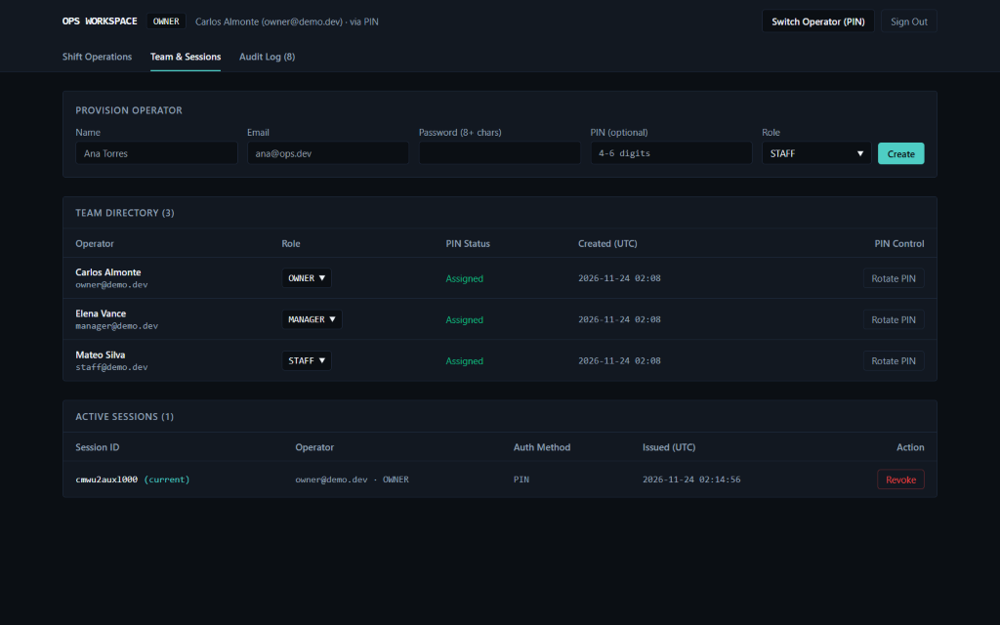
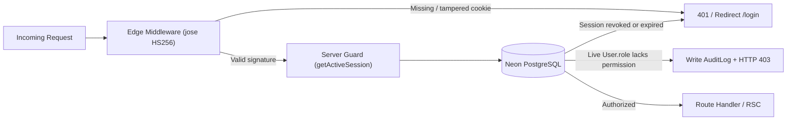

# rbac-auth-workspace

Operational shift management web application featuring hybrid Email/Password + 4–6 digit PIN authentication and server-enforced RBAC.
Built with Next.js App Router, Prisma ORM on Neon Serverless PostgreSQL, Edge-compatible `jose` HS256 cookies, and `crypto.scrypt` hashing.



## Authentication & Authorization Flow



## Why It's Built This Way

- **Database-Backed Session Revocation + Live Role Resolution**: Edge Middleware rejects unsigned or expired cookies cheaply via `jose`, while every Server Component and Route Handler resolves `Session` (`revokedAt IS NULL`) and `User.role` directly from PostgreSQL. Revoking a session or demoting an operator from `MANAGER` to `STAFF` takes effect on the very next HTTP request rather than waiting for JWT expiration.
- **Persistent PIN Lockout State Machine**: Operator PINs are salted and hashed via Node's native `crypto.scrypt` and verified with `timingSafeEqual`. Failed attempts increment `pinFailedCount` in PostgreSQL and enforce a 5-minute `pinLockedUntil` window on the 5th consecutive failure, surviving serverless cold starts across instances.
- **Single-Source Permission Matrix (`src/lib/permissions.ts`)**: Both UI visibility and `requireApiPermission()` read the same declarative role-to-capability map (`OWNER`, `MANAGER`, `STAFF`). Direct `fetch`/`curl` calls from `STAFF` to restricted endpoints return `403 Forbidden` and append an `ACCESS_DENIED_403` row to `AuditLog`.
- **Shared-Terminal Shift Handoff**: Operators can switch active sessions in place via **Switch Operator (PIN)**, which atomically revokes the prior session row, issues a new `HttpOnly; SameSite=Lax` cookie, and records `AUTH_PIN_SWITCH` with both emails in the audit trail.

## Demo Accounts (Seeded)

| Email | Password | Station PIN | Role | Capabilities |
| :--- | :--- | :--- | :--- | :--- |
| `owner@demo.dev` | `DemoOwner!2026` | `1042` | `OWNER` | Provision users, change roles, rotate PINs, revoke sessions, view audit log |
| `manager@demo.dev` | `DemoManager!2026` | `2084` | `MANAGER` | Reconcile (`Verify`) shifts, inspect team directory and audit log |
| `staff@demo.dev` | `DemoStaff!2026` | `3096` | `STAFF` | Record shift entries only (`403` on team/session/audit endpoints) |

## Quick Start (3 Steps)

1. Install dependencies and configure environment:
   ```powershell
   npm install
   Copy-Item .env.example .env
   # Set DATABASE_URL (Neon ?sslmode=require, or run `docker compose up -d` for local Postgres on port 5433)
   ```

2. Push schema and run the idempotent seed:
   ```powershell
   npm run db:push
   npm run db:seed
   ```

3. Verify tests and start the server:
   ```powershell
   npm test
   npm run dev
   ```

## Author

Carlos Almonte (**Haarls**) — [haarls.dev](https://haarls.dev) · [carlos@haarls.dev](mailto:carlos@haarls.dev)
